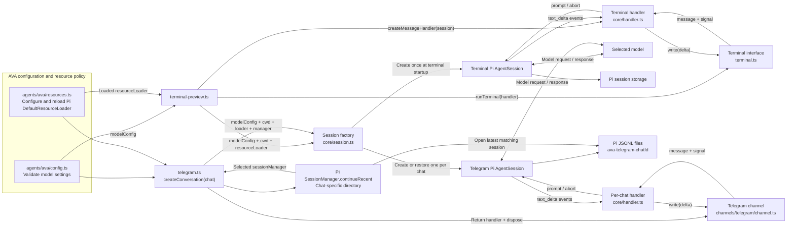
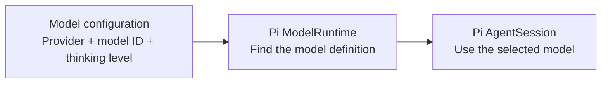
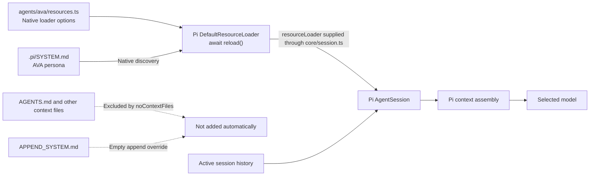
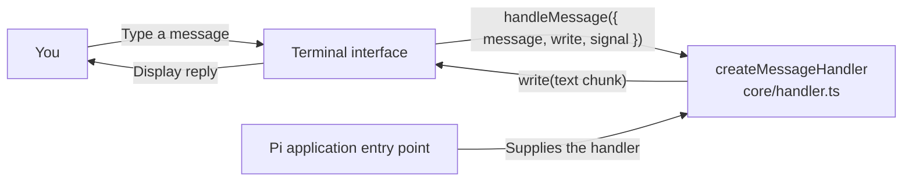
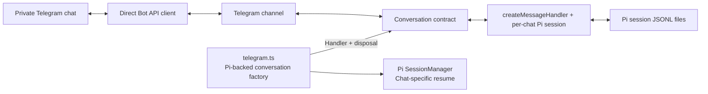
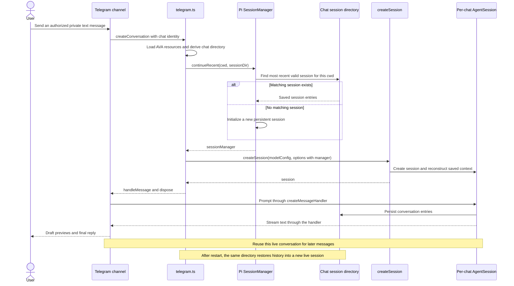

# Ava architecture

Ava uses Pi as its agent harness. The application selects a model and supplies an interface; Pi provides the agent loop, model requests, context assembly, session storage, and tool execution.

## Current milestone

The terminal is connected to Pi through `createMessageHandler(session)`, extracted by the owner into `src/core/handler.ts`. The entry point creates the session and handler, starts the terminal, and disposes the session on exit. The handler owns the per-message subscription, text streaming, and cancellation bridge.

Telegram now uses the same Pi core and AVA configuration through its own application entry point. Each authorized private chat has a separate persistent Pi session. The owner confirmed that restarting the Telegram application resumes the conversation correctly.

Voice is the third Pi-backed channel: Ava Orb maintains the GPT-Live audio session, while `voice-preview.ts` attaches a backend connection and creates a separate Pi conversation. The owner implemented and tested this integration. The voice path now sends incremental transcript batches; its diagram below shows collection, queuing, and the Pi connection.

AVA-specific configuration and resource policy now live in `src/agents/ava/config.ts` and `src/agents/ava/resources.ts`. The terminal supplies both to `createSession(modelConfig, { cwd, resourceLoader })` in `src/core/session.ts`. Telegram also supplies a chat-specific `sessionManager`. The core does not import AVA settings or choose her context policy. Tools remain disabled with `noTools: "all"`. Calendar tools, personal memory, and Pi Durable are future work.

## Current component diagram

All connections below are implemented. Terminal and Telegram reuse the same core functions while keeping separate live sessions and histories.



`terminal-preview.ts` imports `modelConfig`, awaits `createAvaResourceLoader(cwd)`, and calls `createSession(modelConfig, { cwd, resourceLoader })`. It passes the resulting live session to `createMessageHandler` and owns session disposal. The loader and session receive the same working directory. The Telegram entry point composes the same factories for each chat and supplies a `Conversation` with a handler and disposal function. Channel modules remain independent of Pi; sharing factories does not share live sessions.

## Voice channel: GPT-Live with a Pi backend

The owner replaced the simulated conversation with AVA resources, `createSession`, and `createMessageHandler`, and supplied a live log showing backend results returned to GPT-Live and reformulated in its output transcript. Each backend process creates one Pi session and reuses it across delegations. The latest update sends only new transcript fragments rather than resending all voice history.

```mermaid
flowchart LR
    User["You"] <-->|"Audio"| Orb["Ava Orb"]
    Orb <-->|"WebRTC"| Live["GPT-Live session"]
    Live -->|"Transcript deltas + client delegations"| Client["voice/live-client.ts<br/>Backend WebSocket attachment"]
    Client --> Buffer["voice/transcript.ts<br/>Pending fragments"]
    Buffer -->|"takeSnapshot: reserve new arrivals"| Queue["Sequential delegation queue<br/>Disjoint frozen batches"]
    Queue --> Adapter["voice/adapter.ts<br/>createVoiceAdapter"]
    Settings["AVA config + resource loader"] --> Preview["voice-preview.ts"]
    Preview -->|"createSession"| Pi["Voice Pi AgentSession"]
    Preview -->|"Supplies Conversation"| Handler["createMessageHandler<br/>core/handler.ts"]
    Adapter -->|"New transcript batch + signal + write"| Handler
    Handler -->|"prompt / abort"| Pi
    Pi -->|"text_delta"| Handler
    Handler -->|"Text chunks"| Adapter
    Pi <--> History["Pi session history"]
    Adapter -->|"delegationId + complete text"| Client
    Client -->|"session.commentary.append"| Live
```



Responsibilities:

- `voice-preview.ts` reads the Live session ID and API key, loads AVA model settings and resources, creates a Pi session, and supplies its conversation to the adapter. A short message wrapper explains that each transcript batch is incremental and earlier context is already in Pi history. The entry point owns connection shutdown, session abort, and disposal.
- `channels/voice/live-client.ts` validates incoming events, identifies and logs the speaker, manages collection timers and the sequential queue, and sends results with the delegation ID. It reserves the batch before queuing, independently of how long preceding requests take. A socket factory is injectable for local tests; production uses `ws`.
- `channels/voice/transcript.ts` holds only pending arrivals. `takeSnapshot(offsetMs)` drains that buffer into an immutable JSON batch sorted by audio timestamps. Text and spaces are preserved. The offset is metadata, not a cutoff or progress cursor. Late fragments with older or overlapping timestamps remain eligible for the next batch.
- `channels/voice/adapter.ts` invokes the injected `Conversation`, accumulates its `write` calls, honors cancellation, rejects concurrent invocations, and returns `{ delegationId, text }`. The connector serializes calls to it.
- The existing Pi core continues to own prompting, context assembly, and persistent history. Voice modules do not implement a second agent loop or parse Pi session files.

```mermaid
sequenceDiagram
    participant Live as GPT-Live
    participant Client as Voice client
    participant Buffer as Pending transcript fragments
    participant Queue as Delegation queue
    participant Adapter as Voice adapter
    participant Pi as Shared voice Pi session
    Live->>Client: User and assistant transcript deltas
    Client->>Buffer: Append exact text, speaker, and timestamps
    Live->>Client: Client delegation with ID and offset
    Note over Client: Open collection window: 800 ms idle / 2 s maximum
    Live->>Client: More user or assistant fragments
    Client->>Buffer: Append; only user arrivals reset idle timer
    Note over Client: Idle deadline, maximum deadline, or next delegation
    Client->>Buffer: takeSnapshot(offset)
    Buffer-->>Client: New fragments only; pending buffer drained
    Client->>Queue: Reserve immutable batch for this delegation
    Live->>Client: Late fragment, possibly with an older audio timestamp
    Client->>Buffer: Keep for the next delegation
    Queue->>Adapter: Process batch after preceding work settles
    Adapter->>Pi: Prompt through createMessageHandler
    Note over Pi: Earlier batches and replies come from Pi's own history
    Pi-->>Adapter: Stream response text
    Adapter-->>Client: Complete response with delegation ID
    Client->>Live: session.commentary.append
    Live-->>Client: session.commentary.appended
```

### Incremental transcript policy

The first batch contains all valid fragments received since attachment. Each later batch contains only arrivals that were not reserved by a previous batch. Membership uses arrival order rather than an audio timestamp watermark: a delayed fragment must not be discarded simply because its `endMs` is earlier than a previously sent fragment. Sorting affects presentation within each batch, not membership.

Reserving happens at collection close, before queue insertion. A slow handler cannot cause later queued delegations to capture overlapping batches. The connector retains neither a second full transcript nor a cursor into Pi history. New assistant speech remains useful voice context even when it paraphrases an earlier backend reply. If no fragments arrived, the snapshot is empty and the entry point returns a clarification without prompting Pi or replaying the previous request.

A new delegation closes the preceding collection immediately and opens its own window. Both timers are cleared when a window finishes. User arrivals reset the 800 ms idle timer, while the 2-second maximum remains fixed. Assistant output does not extend either timer. This is a collection heuristic, not turn detection: a delivery gap is not proof of silence, and an unrelated utterance can arrive inside the window. Fragments after freezing wait for a later delegation and do not steer active work.

A reserved batch is not automatically replayed after handler or result-delivery failure: the underlying Pi session may already contain its prompt, even if generation failed. The error is reported and later requests keep their own batches. Pending buffers and queued batches are not durable and cannot be recovered after restart. This policy avoids blind duplicate prompts; it does not guarantee exactly-once delivery or lossless recovery.

Closing the connection or receiving a socket error aborts the shared signal and clears collection timers. Frozen requests waiting in the queue are skipped, and active results are not sent after abort. The entry point awaits Pi abort and disposes the session. Individual spoken cancellation and live task steering are not implemented. Result acknowledgement confirms submission to GPT-Live, not that the user heard it.

### Voice session lifetime and validation

The voice entry point uses Pi's default persistent manager and starts a fresh session per backend launch. It does not automatically resume a voice conversation or share Telegram/terminal history. It reuses AVA's `.pi/SYSTEM.md`, context-file policy, explicit model selection, and `noTools: "all"`. The Live voice model and the delegated Pi model are separate choices.

Local tests cover both speakers, collection deadlines, disjoint queued batches, late fragments with old or equal timestamps, empty batches, failure behavior, and shutdown. They inject a fake socket and a local conversation; they do not call Pi or GPT-Live. The owner confirmed the earlier Pi-backed round trip. Incremental delivery is locally verified and still needs a live voice check.

References: [Live transcript deltas](https://developers.openai.com/api/docs/guides/live-conversations#transcript-deltas), [Live delegation](https://developers.openai.com/api/docs/guides/live-delegation), and [server controls](https://developers.openai.com/api/docs/guides/voice-server-controls).

## Model and session setup

The terminal and voice entry points each call `createSession(modelConfig, options)` once at startup, creating separate sessions. Telegram calls it lazily for each chat's first ordinary message in the current process. The factory receives `provider`, `modelId`, and `thinkingLevel`, plus optional native Pi `cwd`, `resourceLoader`, and `sessionManager` options, and returns `Promise<AgentSession>`.



`src/agents/ava/config.ts` reads and validates the environment. `src/core/session.ts` exports the `ModelConfig` interface and the `createSession` factory. The factory creates the Pi model runtime, resolves the supplied provider and model ID, rejects a missing model, and passes the supplied options to Pi's `createAgentSession` with the selected model and thinking level.

`ModelConfig.thinkingLevel` reuses `NonNullable<CreateAgentSessionOptions["thinkingLevel"]>` from the installed SDK. This keeps the supported values aligned with Pi and makes the field required in the application contract. Runtime environment validation remains in AVA's `config.ts`.

The second parameter uses `Pick<CreateAgentSessionOptions, "cwd" | "resourceLoader" | "sessionManager">`. It reuses the SDK's types, and the core forwards these options to Pi. Both AVA entry points supply an already-loaded resource loader. Telegram also selects its persistent manager; the terminal leaves manager creation to Pi's default. Without a supplied loader, Pi uses its default loader.

## AVA configuration and context policy

`src/agents/ava/config.ts` owns model selection from the environment. `src/agents/ava/resources.ts` owns AVA's resource-loading choices. Neither creates a session or implements an agent loop.

`createAvaResourceLoader(cwd)` constructs Pi's `DefaultResourceLoader` with the supplied working directory and `getAgentDir()`, awaits `loader.reload()`, and returns it. Reloading happens before session creation because the SDK does not reload a caller-supplied loader automatically.

| Resource or behavior | Current AVA policy |
| --- | --- |
| Model settings | Validate `AVA_MODEL_PROVIDER`, `AVA_MODEL_ID`, and `AVA_MODEL_THINKING_LEVEL` in `config.ts`. |
| Context files such as `AGENTS.md` | Set `noContextFiles: true` to disable automatic context-file discovery, including coding instructions from the repository, parent directories, and Pi's agent directory. |
| `.pi/SYSTEM.md` | Preserve Pi's native system-prompt discovery for the trusted project. No hardcoded `systemPromptOverride` is supplied. |
| `APPEND_SYSTEM.md` | Keep `appendSystemPromptOverride: () => []`, so these additions are omitted. |
| Skills and extensions | Leave Pi's normal discovery behavior unchanged. The context-file flag does not disable these resources. |
| Session history | Keep Pi's session storage and context assembly. Disabling context files does not disable history or make other saved sessions automatically available. |
| Tools | Keep `noTools: "all"` in the session factory for this milestone. |



These are application choices expressed through Pi's existing options. Pi still assembles the actual model context. The policy is applied when the entry point supplies AVA's loader; it is not a new global default for every core session, and it does not prevent extensions from contributing context through their own hooks.

## Terminal interface: implemented



The `createMessageHandler` factory returns `Conversation["handleMessage"]` from `src/channels/contracts.ts`. Its input is structurally compatible with the existing terminal contract, so no terminal-interface changes were needed. It receives one object containing `message`, `write`, and `signal`:

- `message`: the trimmed, nonempty message entered by the user.
- `write(text)`: immediately appends a text chunk to the terminal. Call it repeatedly for streaming output.
- `signal`: is aborted when the terminal is interrupted or shuts down. A connected handler must cooperate with cancellation.

The terminal awaits each handler before starting the next message. Blank messages are skipped, `/exit` ends the conversation, and handler errors are displayed so another message can be entered. Ctrl+C or SIGTERM requests cancellation of an active handler. End of input finishes queued messages and closes the loop.

The terminal owns its input interface and listeners. It does not own or dispose a Pi session.

## Pi connection: implemented

`src/core/handler.ts` exports `createMessageHandler(session)`. This factory returns a handler that closes over the supplied Pi session; it does not create or dispose a session.

For each message, the handler:

1. Returns immediately if the request signal is already aborted.
2. Subscribes before prompting and forwards `message_update` / `text_delta` events to `write`, unless cancellation has been requested.
3. Bridges the abort signal to `session.abort()`.
4. Awaits `session.prompt(message)`.
5. Removes the abort listener and subscription in `finally`.

`src/terminal-preview.ts` creates one session with `createSession(modelConfig, { cwd, resourceLoader })`, passes it to `createMessageHandler`, and awaits `runTerminal(handleMessage)`. Its outer `finally` disposes the session when the terminal finishes.

The prompt and subscription must use the same live session object. Reuse that object across messages so Pi maintains the conversation history. The handler does not implement a queue: the terminal already awaits each invocation. If multiple channels later target one live session, serialization must be enforced across those callers; sharing handler code does not require sharing a session.

## Conversation sequence

```mermaid
sequenceDiagram
    actor User
    participant App as terminal-preview.ts
    participant Resources as AVA resource factory
    participant Loader as Pi DefaultResourceLoader
    participant Factory as createSession (core/session.ts)
    participant Terminal as Terminal interface
    participant Handler as createMessageHandler
    participant Pi as Pi AgentSession
    participant Model as Selected model
    Note over App: Import modelConfig from agents/ava/config.ts and choose cwd
    App->>Resources: await createAvaResourceLoader(cwd)
    Resources->>Loader: Construct with AVA resource options
    Resources->>Loader: await reload()
    Loader-->>Resources: Resources loaded
    Resources-->>App: resourceLoader
    App->>Factory: await createSession(modelConfig, { cwd, resourceLoader })
    Factory->>Pi: Create session with selected model and resources
    Factory-->>App: session
    App->>Handler: createMessageHandler(session)
    Handler-->>App: handleMessage
    App->>Terminal: await runTerminal(handleMessage)
    Note over Handler,Pi: Same live session across this terminal conversation
    loop Each user message (sequential)
        User->>Terminal: Enter a message
        Terminal->>Handler: await handleMessage({ message, write, signal })
        Handler->>Pi: Subscribe to session events
        Note over Handler,Pi: Request abort signal calls session.abort()
        Handler->>Pi: await session.prompt(message)
        Pi->>Pi: Assemble context from the active session
        Pi->>Model: Send model request
        loop Response text arrives
            Model-->>Pi: Text chunk
            Pi-->>Handler: message_update / text_delta
            Handler->>Terminal: write(delta), unless aborted
            Terminal-->>User: Display text chunk
        end
        Pi->>Pi: Record the completed message
        Pi-->>Handler: Prompt finishes
        Handler->>Pi: Unsubscribe in finally
        Note over Handler: Remove abort listener in finally
        Handler-->>Terminal: Handler finishes
    end
    User->>Terminal: /exit
    Terminal-->>App: Input loop finishes
    App->>Pi: Dispose session in finally
```



The sequence is simplified to ordinary text messages without tools. Pi also manages run events, retries, and context changes internally. Cancellation requests and prompt failures still pass through the handler's cleanup path.

## Files and responsibilities

```text
AGENTS.md                    Coding-agent guidelines
.pi/
  SYSTEM.md                  AVA runtime persona
src/
  agents/
    ava/
      config.ts              AVA environment validation and model configuration
      resources.ts           AVA policy through Pi DefaultResourceLoader
  core/
    session.ts               ModelConfig and createSession(modelConfig, options)
    handler.ts               createMessageHandler: prompt, stream, and abort
  channels/
    contracts.ts             Conversation identity, handler, and cleanup contract
    telegram/
      settings.ts            Telegram environment validation
      bot-api.ts             Direct Telegram Bot API client
      channel.ts             Polling, authorization, queues, streaming, and cleanup
    voice/
      adapter.ts             Conversation callback to delegation result
      live-client.ts         GPT-Live attachment, collection timers, queue, and results
      transcript.ts          Pending transcript fragments and incremental batches
  terminal.ts                Input loop and streamed text output
  terminal-preview.ts        Create session and handler, run terminal, dispose session
  telegram.ts                AVA Telegram composition and per-chat Pi session resume
  telegram-identify.ts       Local Telegram user-ID discovery
  voice-preview.ts           Attach GPT-Live to one Pi-backed AVA conversation
test/
  terminal.test.mjs          Terminal behavior checks with local callbacks
  telegram.test.mjs          Telegram checks with a fake API
  voice.test.mjs             Voice checks with a fake socket and controlled timers
```

| Module | Input | Responsibility | Output / lifecycle |
| --- | --- | --- | --- |
| `src/agents/ava/config.ts` | `AVA_*` environment values | Validate provider, model ID, and thinking level. | Export `modelConfig`; create no Pi runtime or session. |
| `src/agents/ava/resources.ts` | `cwd` | Apply AVA policy using native Pi options and await resource loading. | Return a loaded `DefaultResourceLoader`; create no session. |
| `src/core/session.ts` | `ModelConfig` and native `cwd` / `resourceLoader` / `sessionManager` options | Resolve the model and call Pi's `createAgentSession`. | Return a live `AgentSession`; the caller owns disposal. |
| `src/core/handler.ts` | A live `AgentSession` | Adapt channel messages to Pi prompting, streaming, and cancellation. | Return `Conversation["handleMessage"]`; clean up each message's listeners. |
| `src/terminal-preview.ts` | AVA config and resource factory, core factories, terminal interface | Compose one terminal conversation using the same `cwd` for resources and session. | Await resources, create session and handler, run the terminal, and dispose the session in `finally`. |
| `src/terminal.ts` | A message handler | Read input, process messages sequentially, display reply chunks, and signal shutdown. | Own the terminal interface and its listeners. |
| `src/channels/contracts.ts` | No runtime setup | Define channel messages, identity, conversation handling, and cleanup. | Supply types without a Pi dependency. |
| `src/channels/telegram/` | Telegram settings and an injected conversation factory | Authorize users, poll updates, queue per chat, and deliver replies. | Manage channel lifecycle and call each conversation's cleanup. |
| `src/telegram.ts` | Telegram settings, AVA config and resources, chat identity, core factories | Select each chat's persistent manager and compose its Pi conversation. | Return handler and session disposal to the channel; make real model calls through the handler. |
| `src/channels/voice/` | Live events and an injected conversation | Reserve new transcript fragments into disjoint batches, serialize delegations, and return results. | Keep only pending fragments per connection; abort timers and work on close. No Pi dependency. |
| `src/voice-preview.ts` | Live session ID, `OPENAI_API_KEY`, AVA settings/resources, core factories | Create one Pi conversation and explain the incremental transcript format before each prompt. | Own connection cleanup and Pi abort/disposal; make real model requests. |
| Pi SDK | Configuration, messages, and registered resources | Manage the agent loop, context, model requests, and session history. | Provide the live session used by the application. |

The terminal uses Pi's default persistent manager and creates a fresh session on each launch. Telegram supplies `SessionManager.continueRecent(cwd, sessionDir)` and resumes the most recent matching session in that chat's dedicated directory. Both reuse the same live object for messages within one conversation.

## Run the terminal application

From the repository root:

```sh
npm run terminal
```

The command builds the application and loads `.env` before importing the settings module. Configure `AVA_MODEL_PROVIDER`, `AVA_MODEL_ID`, and `AVA_MODEL_THINKING_LEVEL` as described in the README, and configure the selected provider's credentials through Pi. This entry point makes real model requests. Use `/exit` to finish or Ctrl+C to cancel and exit.

```sh
npm run typecheck
npm test
```

The tests check streamed output, sequential messages, empty input, exit handling, errors, end of input, and cooperative cancellation. They do not make model requests.

AVA's resource factory uses Pi's native `.pi/SYSTEM.md` discovery while excluding automatic context files and append-system additions, as described above. Keep credentials in your local environment or Pi's authentication storage.

## Decisions

- Keep the terminal independent of Pi through a small callback contract.
- Keep the extracted handler independent of AVA configuration; it receives an existing session.
- Pass model configuration, native resource options, and optional session-manager selection into `createSession`; keep AVA environment access and context policy in `src/agents/ava/`.
- Reuse `DefaultResourceLoader` and SDK types; do not create a parallel context manager. Keep `.pi/SYSTEM.md` in its native location.
- Keep session lifetime in application setup and per-message cleanup in the handler.
- Do not duplicate Pi's agent loop or persistent history. The voice prototype keeps only a temporary transcript buffer needed to assemble delegated requests.
- Use one Pi session per terminal conversation, one separate Pi session per Telegram chat, and one voice Pi session per backend launch.
- Keep chat identity routing in application setup and persistence/context reconstruction in Pi's `SessionManager`. Use a directory per Telegram chat; no separate transcript or mapping database is needed for the current policy.
- Let Pi own context assembly and history; do not duplicate them in the terminal.
- Use Node's built-in readline and test tools. The voice attachment uses `ws`; no new framework is introduced.
- Keep tools disabled for the first conversation milestone.

## Pi references

- [SDK: configuring a session](https://pi.dev/docs/latest/sdk#configuring-a-session)
- [Configuration: project Pi directory](https://pi.dev/docs/latest/configuration#project-pi-directory)
- [SDK: subscribing to events](https://pi.dev/docs/latest/sdk#subscribing-to-events)
- [SDK: session storage](https://pi.dev/docs/latest/sdk#session-storage)
- [Official session-management example](https://github.com/earendil-works/pi/blob/main/packages/coding-agent/examples/sdk/11-sessions.ts)
- [Official minimal SDK example](https://github.com/earendil-works/pi/blob/main/packages/coding-agent/examples/sdk/01-minimal.ts)

The API notes above were checked against the project's installed Pi SDK, version 1.1.0.

## Telegram channel milestone

The Telegram channel remains independent of Pi. Its entry point now supplies real AVA conversations: it loads AVA resources, selects each chat's persistent manager, calls `createSession`, and returns `createMessageHandler(session)` plus session disposal. Terminal and Telegram reuse the core and AVA configuration.



- `src/channels/contracts.ts` defines the handler, abort signal, text-delta callback, identity, and cleanup function without importing Pi.
- `src/channels/telegram/bot-api.ts` owns HTTP calls and response validation. `fetch` is injectable for local tests; errors omit token-bearing request URLs.
- `src/channels/telegram/channel.ts` owns authorization, polling, queues, commands, coalesced streaming previews, final delivery, and lifecycle. Polling continues while a handler runs. Cancellation interrupts the active request and clears its chat's pending queue.
- `src/telegram.ts` wires the channel to the Pi handler and logs the chosen session ID and file path. Its model settings are loaded at startup; resources and sessions are initialized lazily per chat.
- `src/telegram-identify.ts` helps identify the owner locally before starting polling. It sends no messages and must not run alongside another poller for the same bot.

One live conversation object is reused per chat and disposed on shutdown. The handler must honor its abort signal; shutdown waits for active handlers to settle. Pending work and offsets are held in memory. Pi session persistence and conversation resume are supplied by application setup. Queue/offset recovery and delivery retries remain deferred. Advancing a polling offset acknowledges updates; it is not proof that their replies were delivered.

Validation: fourteen Telegram tests and four terminal tests exercise channel behavior without network or model requests. On 2026-10-12, the owner tested the real Pi-backed bot in Telegram and confirmed that the conversation resumed correctly after restarting. This is owner-confirmed live verification; the local channel tests do not exercise that restart path end to end.

## Telegram session persistence and restart sequence

`conversationId` is the Telegram chat ID supplied by the channel after its private-chat and allowed-user checks. `src/telegram.ts` derives the storage directory as:

```ts
join(getAgentDir(), "sessions", `ava-telegram-${conversationId}`)
```

With Pi's default agent directory, the layout is:

```text
~/.pi/agent/sessions/
  ava-telegram-<chat-id>/
    <timestamp>_<pi-session-id>.jsonl
```

The stable directory is the chat-to-history association. `SessionManager.continueRecent(cwd, sessionDir)` opens the most recent valid session matching the current `cwd`, or creates a new manager if none exists. Pi owns the JSONL format, writes conversation entries, and rebuilds the active branch and compacted context. AVA does not parse or replay transcript files manually.



Session persistence and delivery recovery are separate: pending channel requests and polling offsets remain in memory, and generated responses are not automatically redelivered after a restart. This milestone assumes one bot, one active process, and a stable `cwd` and agent directory. Explicit model and thinking settings still come from AVA's current environment configuration.

## Evolution: AVA settings and resource policy separated from Pi setup

Completed by the owner on 2026-10-12:

- Replaced `src/config/runtime.ts` with the reusable `src/core/session.ts` factory.
- Moved `src/config/settings.ts` to `src/agents/ava/config.ts`, preserving model validation.
- Added `src/agents/ava/resources.ts` to configure and reload Pi's native loader with AVA's context policy.
- Extended `createSession` to accept native `cwd` and `resourceLoader` options through `Pick<CreateAgentSessionOptions, "cwd" | "resourceLoader">`.
- Connected configuration, resource loading, session creation, and the existing handler in `src/terminal-preview.ts`.
- Preserved streaming, cancellation, cleanup, session persistence, and disabled tools. The core has no import from `agents/ava`.

The component and sequence diagrams above show the implemented setup and message flow. This step changes which module chooses resources; Pi still owns resource discovery, context assembly, and session storage.

## Evolution: Telegram connected to persistent Pi conversations

Completed by the owner on 2026-10-12:

- Added native `sessionManager` injection to `createSession`.
- Replaced the simulated Telegram conversation factory with AVA resources, a chat-specific `SessionManager.continueRecent`, the shared Pi handler, and session disposal.
- Kept terminal and Telegram histories separate, with stable storage paths derived from Telegram chat IDs.
- Updated the startup and welcome messages to reflect real conversations.
- Tested the real bot and confirmed session resume after restarting the application.

## Remaining steps

1. Move the terminal interface and refactor its entry point when the owner is ready; the current path still works.
2. Add focused automated coverage for per-chat Pi persistence and resume. Current automated tests cover channel behavior through injected conversations.
3. Implement the deferred delivery recovery policy when requested. Calendar tools, personal memory, and Pi Durable remain separate future milestones.
4. Test incremental voice delivery with the live Orb call. The voice adapter is connected to Pi; automatic voice-session resume, task steering, and durable delivery remain future work.

Further integration remains owner-led unless implementation is explicitly delegated. Terminal, Telegram, and voice are connected to Pi with separate session lifetimes. Telegram conversation resume is implemented and confirmed by the owner.

## Latest verification

On 2026-10-12, `npm run typecheck` and `npm test` passed: 31 local tests (four terminal, fourteen Telegram, and thirteen voice). The test command also compiles the project. Voice tests use the real adapter with an injected fake WebSocket, a local conversation, and controlled timers. No network or model requests are made, so they do not verify live GPT-Live delivery or Pi persistence end to end.

Earlier live checks were performed by the owner: Telegram session resume after restarting, the simulated voice round trip, and then Pi-backed voice responses confirmed in the supplied logs. The incremental transcript update has local coverage and awaits a live check. The owner's Pi integration was preserved; only the voice prompt wrapper and log wording changed to describe incremental input.
