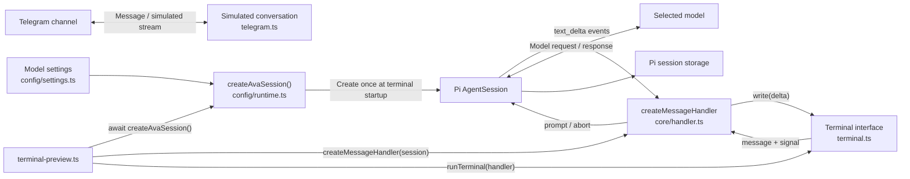
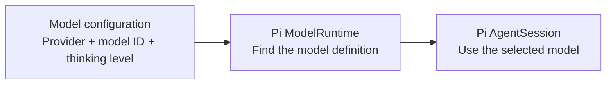
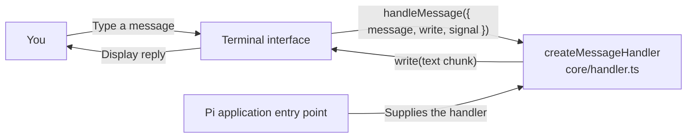
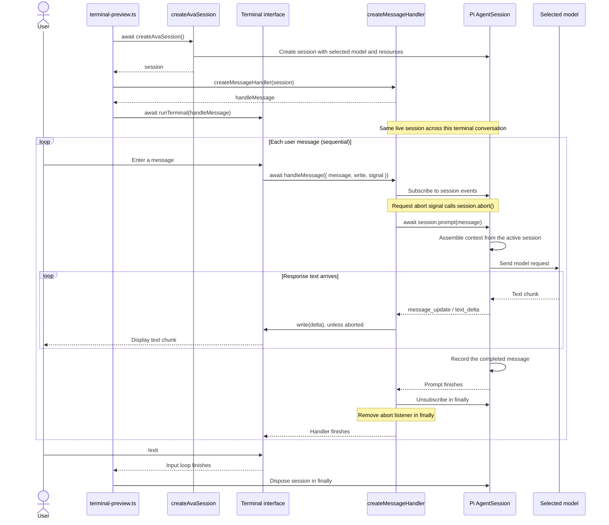
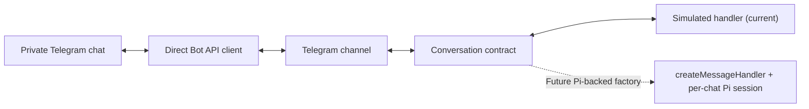
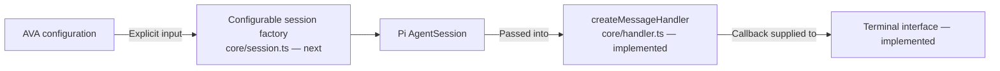

# Ava architecture

Ava uses Pi as its agent harness. The application selects a model and supplies an interface; Pi provides the agent loop, model requests, context assembly, session storage, and tool execution.

## Current milestone

The terminal is connected to Pi through `createMessageHandler(session)`, extracted by the owner into `src/core/handler.ts`. The entry point creates the session and handler, starts the terminal, and disposes the session on exit. The handler owns the per-message subscription, text streaming, and cancellation bridge.

Telegram is implemented as a separate channel with simulated replies. It does not use the Pi handler yet.

The session factory already exists and configures `noTools: "all"`. Calendar tools, personal memory, and Pi Durable are future work.

## Current component diagram

Solid arrows below describe implemented connections. The Telegram preview remains separate from the Pi conversation.



`terminal-preview.ts` calls the factory and passes the resulting live session to `createMessageHandler`. It owns session disposal. The terminal and Telegram channel use structurally compatible message contracts, but only the terminal is currently connected to this Pi handler.

## Model and session setup

The application entry point calls `createAvaSession()` once at startup. That factory performs the following setup.



`settings.ts` reads and validates the environment. `runtime.ts` creates the Pi runtime, looks up the configured model, checks that it exists, and creates a session with the selected thinking level.

## Terminal interface: implemented



The `createMessageHandler` factory returns `Conversation["handleMessage"]` from `src/channels/contracts.ts`. Its input is structurally compatible with the existing terminal contract, so no terminal-interface changes were needed. It receives one object containing `message`, `write`, and `signal`:

- `message`: the trimmed, nonempty message entered by the user.
- `write(text)`: immediately appends a text chunk to the terminal. Call it repeatedly for streaming output.
- `signal`: is aborted when the terminal is interrupted or shuts down. A connected handler must cooperate with cancellation.

The terminal awaits each handler before starting the next message. Blank messages are skipped, `/exit` ends the conversation, and handler errors are displayed so another message can be entered. Ctrl+C or SIGTERM requests cancellation of an active handler. End of input finishes queued messages and closes the loop.

The terminal owns its input interface and listeners. It does not own or dispose a Pi session.

## Pi connection: implemented

`src/core/handler.ts` exports `createMessageHandler(session)`. This factory returns a handler that closes over the supplied Pi session; it does not create or dispose a session.

For each message, the handler:

1. Returns immediately if the request signal is already aborted.
2. Subscribes before prompting and forwards `message_update` / `text_delta` events to `write`, unless cancellation has been requested.
3. Bridges the abort signal to `session.abort()`.
4. Awaits `session.prompt(message)`.
5. Removes the abort listener and subscription in `finally`.

`src/terminal-preview.ts` creates one session with `createAvaSession()`, passes it to `createMessageHandler`, and awaits `runTerminal(handleMessage)`. Its outer `finally` disposes the session when the terminal finishes.

The prompt and subscription must use the same live session object. Reuse that object across messages so Pi maintains the conversation history. The handler does not implement a queue: the terminal already awaits each invocation. If multiple channels later target one live session, serialization must be enforced across those callers; sharing handler code does not require sharing a session.

## Conversation sequence



The sequence is simplified to ordinary text messages without tools. Pi also manages run events, retries, and context changes internally. Cancellation requests and prompt failures still pass through the handler's cleanup path.

## Files and responsibilities

```text
AGENTS.md                    Coding-agent guidelines
.pi/
  SYSTEM.md                  AVA runtime persona
src/
  config/
    settings.ts              Environment validation and model configuration
    runtime.ts               Existing AVA-specific Pi session factory
  core/
    handler.ts               createMessageHandler: prompt, stream, and abort
  channels/
    contracts.ts             Conversation identity, handler, and cleanup contract
    telegram/
      settings.ts            Telegram environment validation
      bot-api.ts             Direct Telegram Bot API client
      channel.ts             Polling, authorization, queues, streaming, and cleanup
  terminal.ts                Input loop and streamed text output
  terminal-preview.ts        Create session and handler, run terminal, dispose session
  telegram.ts                Telegram entry point with simulated conversations
  telegram-identify.ts       Local Telegram user-ID discovery
test/
  terminal.test.mjs          Terminal behavior checks with local callbacks
  telegram.test.mjs          Telegram checks with a fake API
```

| Component | Responsibility |
| --- | --- |
| Model configuration | Validate provider, model ID, and thinking level. |
| Session factory | Create Pi's runtime, resolve the model, load resources, and create the session. Currently imports AVA's global model configuration. |
| Pi message handler | Adapt the channel contract to Pi's prompt, subscription, and cancellation APIs; clean up each message's listeners. |
| Terminal interface | Read input, await the handler, display reply chunks, and handle shutdown. |
| Application entry point | Create the session and handler, run the terminal, and dispose the session. |
| Telegram channel | Receive authorized messages, serialize work per chat, and deliver streaming previews and final replies through an injected conversation factory. |
| Pi | Manage the agent loop, context, model requests, and session history. |

The factory uses Pi's default persistent session manager. Each application run creates a new session, and messages within that run share its history. Continuing a previous saved session is not implemented yet.

## Run the terminal application

From the repository root:

```sh
npm run terminal
```

The command builds the application and loads `.env` before importing the settings module. Configure `AVA_MODEL_PROVIDER`, `AVA_MODEL_ID`, and `AVA_MODEL_THINKING_LEVEL` as described in the README, and configure the selected provider's credentials through Pi. This entry point makes real model requests. Use `/exit` to finish or Ctrl+C to cancel and exit.

```sh
npm run typecheck
npm test
```

The tests check streamed output, sequential messages, empty input, exit handling, errors, end of input, and cooperative cancellation. They do not make model requests.

The runtime uses `DefaultResourceLoader` to discover `.pi/SYSTEM.md` for a trusted project. It does not set a hardcoded system prompt override, and it disables automatic `APPEND_SYSTEM.md` additions. Pi also discovers `AGENTS.md` as project context; the root file scopes its instructions to coding work. Keep credentials in your local environment or Pi's authentication storage.

## Decisions

- Keep the terminal independent of Pi through a small callback contract.
- Keep the extracted handler independent of AVA configuration; it receives an existing session.
- Make the session factory configurable next; do not introduce another agent loop or transcript store.
- Use one Pi session per terminal conversation.
- Let Pi own context assembly and history; do not duplicate them in the terminal.
- Use Node's built-in readline and test tools; no additional runtime dependencies.
- Keep tools disabled for the first conversation milestone.

## Pi references

- [SDK: subscribing to events](https://pi.dev/docs/latest/sdk#subscribing-to-events)
- [SDK: session storage](https://pi.dev/docs/latest/sdk#session-storage)
- [Official minimal SDK example](https://github.com/earendil-works/pi/blob/main/packages/coding-agent/examples/sdk/01-minimal.ts)

The API notes above were checked against the project's installed Pi SDK, version 1.1.0.

## Telegram channel milestone

The Telegram channel is implemented independently of Pi. Its current entry point supplies a simulated streaming conversation. The Pi handler has been extracted and is used by the terminal. A configurable session factory, AVA definition, persistent chat-session mapping, and Telegram wiring remain owner work.



- `src/channels/contracts.ts` defines the handler, abort signal, text-delta callback, identity, and cleanup function without importing Pi.
- `src/channels/telegram/bot-api.ts` owns HTTP calls and response validation. `fetch` is injectable for local tests; errors omit token-bearing request URLs.
- `src/channels/telegram/channel.ts` owns authorization, polling, queues, commands, coalesced streaming previews, final delivery, and lifecycle. Polling continues while a handler runs. Cancellation interrupts the active request and clears its chat's pending queue.
- `src/telegram.ts` wires the channel to a simulated handler. The owner will replace this factory with Pi-backed conversations; model configuration is not required for the preview.
- `src/telegram-identify.ts` helps identify the owner locally before starting polling. It sends no messages and must not run alongside another poller for the same bot.

One live conversation object is reused per chat and disposed on shutdown. The handler must honor its abort signal; shutdown waits for active handlers to settle. Pending work and offsets are held in memory. Session persistence, restart recovery, and delivery retries are not implemented by this channel. Advancing a polling offset acknowledges updates; it is not proof that their replies were delivered.

Validation: fourteen new Telegram tests and four existing terminal tests pass without network or model requests. The owner confirmed receipt of a simulated Telegram reply. Real Pi integration remains untested because it is deliberately not connected yet.

## Next step: a configurable session factory

The handler extraction is complete. The next owner-led step is to separate AVA's settings from Pi initialization:

1. Introduce a session factory in `src/core/session.ts` that receives validated model settings rather than importing AVA's module-level `modelConfig`.
2. Keep model lookup, resource loading, and Pi session creation inside that factory. Keep tools disabled and pass the working directory and resource policy explicitly as this boundary is extracted.
3. Let application setup supply AVA's configuration and keep session ownership and disposal outside the message handler. The later AVA definition belongs in `src/agents/ava/`.
4. Apply the agreed `noContextFiles: true` policy for AVA while preserving `.pi/SYSTEM.md` discovery. This setting is not present in the current runtime yet.



This is a dependency and setup diagram, not the message direction. For this step, preserve the terminal's current streaming and cancellation behavior. Persistent per-chat sessions, Telegram–Pi wiring, the terminal folder move, and delivery recovery follow separately; they are not part of the completed handler extraction.

## Latest verification

The handler extraction passed `npm run typecheck` and `git diff --check` on 2026-10-12. This confirmed type compatibility and a source review of the terminal wiring; no live model request or test-suite rerun was performed for that review. The eighteen passing tests mentioned in the Telegram milestone refer to the earlier channel implementation. This architecture update changes documentation only.
