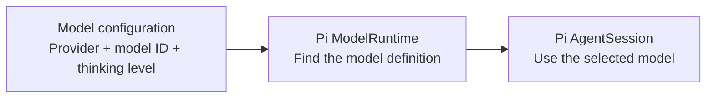
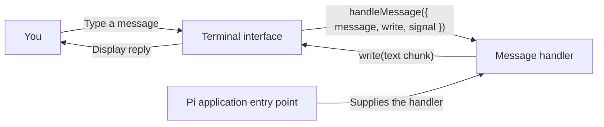
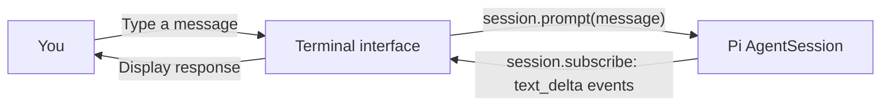
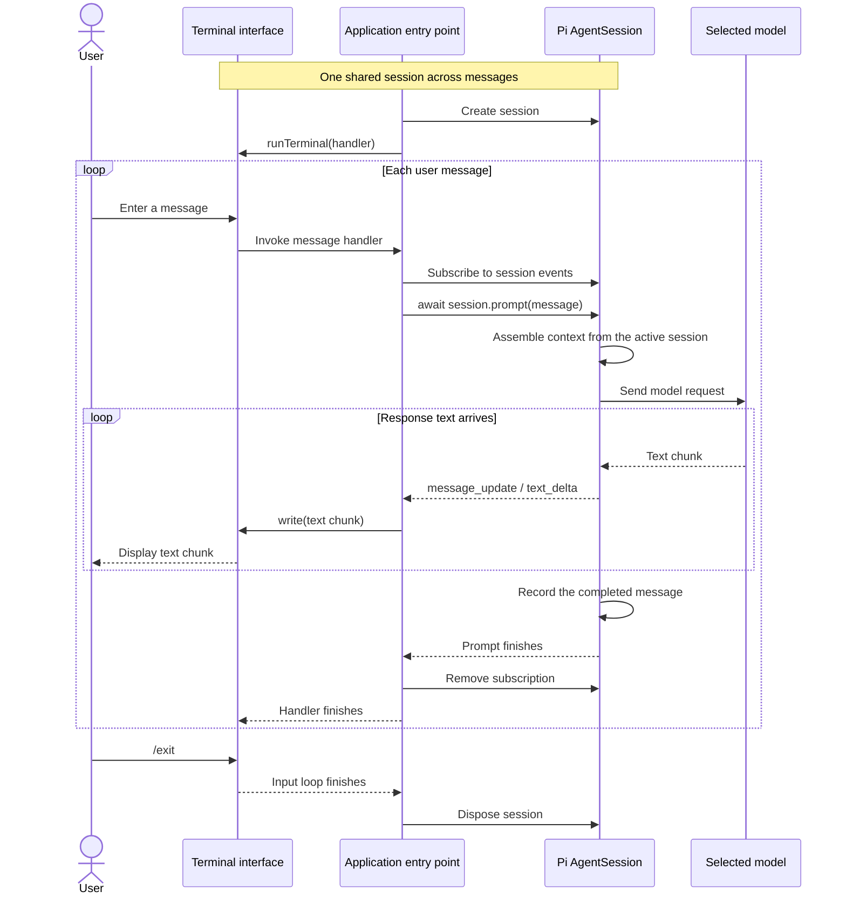

# Ava architecture

Ava uses Pi as its agent harness. The application selects a model and supplies an interface; Pi provides the agent loop, model requests, context assembly, session storage, and tool execution.

## Current milestone

The terminal is connected to Pi. The application entry point creates one session, streams text through the terminal callback, bridges cancellation to Pi, and disposes the session on exit.

The session factory already exists and configures `noTools: "all"`. Calendar tools, personal memory, and Pi Durable are future work.

## Model and session setup

The application entry point calls `createAvaSession()` once at startup. That factory performs the following setup.



`settings.ts` reads and validates the environment. `runtime.ts` creates the Pi runtime, looks up the configured model, checks that it exists, and creates a session with the selected thinking level.

## Terminal interface: implemented



The handler receives one object containing `message`, `write`, and `signal`:

- `message`: the trimmed, nonempty message entered by the user.
- `write(text)`: immediately appends a text chunk to the terminal. Call it repeatedly for streaming output.
- `signal`: is aborted when the terminal is interrupted or shuts down. A connected handler must cooperate with cancellation.

The terminal awaits each handler before starting the next message. Blank messages are skipped, `/exit` ends the conversation, and handler errors are displayed so another message can be entered. Ctrl+C or SIGTERM requests cancellation of an active handler. End of input finishes queued messages and closes the loop.

The terminal owns its input interface and listeners. It does not own or dispose a Pi session.

## Pi connection: implemented

The application entry point connects the terminal callback to the same live Pi session for every message.



The application entry point creates one session. For each message, it subscribes before prompting, forwards each text delta to `write`, and awaits the prompt before completing the handler. It bridges cancellation to `session.abort()`, removes the subscription and abort listener after each message, and disposes the session when the application exits.

The prompt and subscription must use the same live session object. Reuse that object across messages so Pi maintains the conversation history.

## Conversation sequence



The sequence is simplified to ordinary text messages without tools. Pi also manages run events, retries, and context changes internally.

## Files and responsibilities

```text
AGENTS.md                Coding-agent guidelines
.pi/
  SYSTEM.md              AVA runtime persona
src/
  config/
    settings.ts          Environment validation and model configuration
    runtime.ts           Existing Pi session factory
  terminal.ts            Input loop and streamed text output
  terminal-preview.ts    Pi connection, streaming, cancellation, and cleanup
test/
  terminal.test.mjs       Terminal behavior checks with local callbacks
```

| Component | Responsibility |
| --- | --- |
| Model configuration | Validate provider, model ID, and thinking level. |
| Session factory | Create Pi's runtime, resolve the model, and create the session. |
| Terminal interface | Read input, invoke the handler, display reply chunks, and handle shutdown. |
| Application entry point | Connect the terminal to one Pi session and own its lifetime. |
| Pi | Manage the agent loop, context, model requests, and session history. |

The factory uses Pi's default persistent session manager. Each application run creates a new session, and messages within that run share its history. Continuing a previous saved session is not implemented yet.

## Run the terminal application

From the repository root:

```sh
npm run terminal
```

The command builds the application and loads `.env` before importing the settings module. Configure `AVA_MODEL_PROVIDER`, `AVA_MODEL_ID`, and `AVA_MODEL_THINKING_LEVEL` as described in the README, and configure the selected provider's credentials through Pi. This entry point makes real model requests. Use `/exit` to finish or Ctrl+C to cancel and exit.

```sh
npm run typecheck
npm test
```

The tests check streamed output, sequential messages, empty input, exit handling, errors, end of input, and cooperative cancellation. They do not make model requests.

The runtime uses `DefaultResourceLoader` to discover `.pi/SYSTEM.md` for a trusted project. It does not set a hardcoded system prompt override, and it disables automatic `APPEND_SYSTEM.md` additions. Pi also discovers `AGENTS.md` as project context; the root file scopes its instructions to coding work. Keep credentials in your local environment or Pi's authentication storage.

## Decisions

- Keep the terminal independent of Pi through a small callback contract.
- Preserve the existing model configuration and session factory.
- Use one Pi session per terminal conversation.
- Let Pi own context assembly and history; do not duplicate them in the terminal.
- Use Node's built-in readline and test tools; no additional runtime dependencies.
- Keep tools disabled for the first conversation milestone.

## Pi references

- [SDK: subscribing to events](https://pi.dev/docs/latest/sdk#subscribing-to-events)
- [SDK: session storage](https://pi.dev/docs/latest/sdk#session-storage)
- [Official minimal SDK example](https://github.com/earendil-works/pi/blob/main/packages/coding-agent/examples/sdk/01-minimal.ts)

The API notes above were checked against the project's installed Pi SDK, version 1.1.0.
