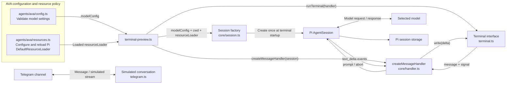
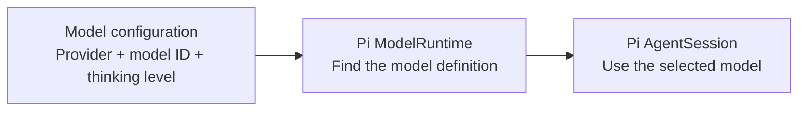
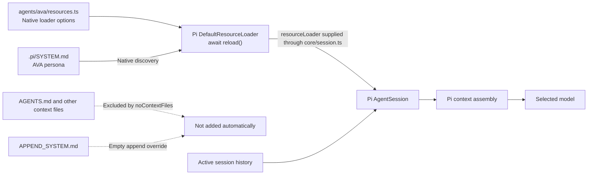
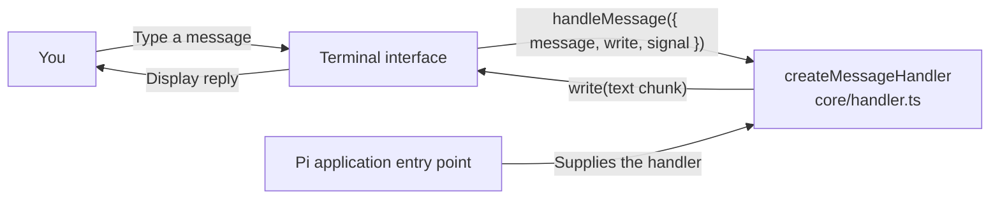
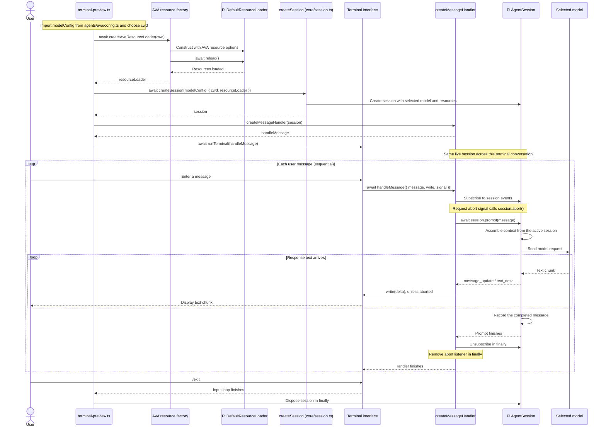
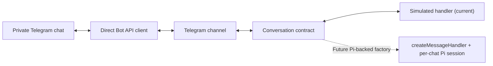

# Ava architecture

Ava uses Pi as its agent harness. The application selects a model and supplies an interface; Pi provides the agent loop, model requests, context assembly, session storage, and tool execution.

## Current milestone

The terminal is connected to Pi through `createMessageHandler(session)`, extracted by the owner into `src/core/handler.ts`. The entry point creates the session and handler, starts the terminal, and disposes the session on exit. The handler owns the per-message subscription, text streaming, and cancellation bridge.

Telegram is implemented as a separate channel with simulated replies. It does not use the Pi handler yet.

AVA-specific configuration and resource policy now live in `src/agents/ava/config.ts` and `src/agents/ava/resources.ts`. The terminal supplies both to `createSession(modelConfig, { cwd, resourceLoader })` in `src/core/session.ts`. The core does not import AVA settings or choose her context policy. Tools remain disabled with `noTools: "all"`. Calendar tools, personal memory, and Pi Durable are future work.

## Current component diagram

Solid arrows below describe implemented connections. The Telegram preview remains separate from the Pi conversation.



`terminal-preview.ts` imports `modelConfig`, awaits `createAvaResourceLoader(cwd)`, and calls `createSession(modelConfig, { cwd, resourceLoader })`. It passes the resulting live session to `createMessageHandler` and owns session disposal. The loader and session receive the same working directory. The terminal and Telegram channel use structurally compatible message contracts, but only the terminal is currently connected to this Pi handler.

## Model and session setup

The application entry point calls `createSession(modelConfig, options)` once at startup. The factory receives `provider`, `modelId`, and `thinkingLevel`, plus optional native Pi `cwd` and `resourceLoader` options, and returns `Promise<AgentSession>`.



`src/agents/ava/config.ts` reads and validates the environment. `src/core/session.ts` exports the `ModelConfig` interface and the `createSession` factory. The factory creates the Pi model runtime, resolves the supplied provider and model ID, rejects a missing model, and passes the supplied options to Pi's `createAgentSession` with the selected model and thinking level.

`ModelConfig.thinkingLevel` reuses `NonNullable<CreateAgentSessionOptions["thinkingLevel"]>` from the installed SDK. This keeps the supported values aligned with Pi and makes the field required in the application contract. Runtime environment validation remains in AVA's `config.ts`.

The second parameter uses `Pick<CreateAgentSessionOptions, "cwd" | "resourceLoader">`. This selects the SDK's existing types rather than defining a competing configuration API. The core forwards these options; AVA's entry point supplies the already-loaded resource loader. Without one, Pi uses its default loader. Session-manager selection is not exposed by this factory yet.

## AVA configuration and context policy

`src/agents/ava/config.ts` owns model selection from the environment. `src/agents/ava/resources.ts` owns AVA's resource-loading choices. Neither creates a session or implements an agent loop.

`createAvaResourceLoader(cwd)` constructs Pi's `DefaultResourceLoader` with the supplied working directory and `getAgentDir()`, awaits `loader.reload()`, and returns it. Reloading happens before session creation because the SDK does not reload a caller-supplied loader automatically.

| Resource or behavior | Current AVA policy |
| --- | --- |
| Model settings | Validate `AVA_MODEL_PROVIDER`, `AVA_MODEL_ID`, and `AVA_MODEL_THINKING_LEVEL` in `config.ts`. |
| Context files such as `AGENTS.md` | Set `noContextFiles: true` to disable automatic context-file discovery, including coding instructions from the repository, parent directories, and Pi's agent directory. |
| `.pi/SYSTEM.md` | Preserve Pi's native system-prompt discovery for the trusted project. No hardcoded `systemPromptOverride` is supplied. |
| `APPEND_SYSTEM.md` | Keep `appendSystemPromptOverride: () => []`, so these additions are omitted. |
| Skills and extensions | Leave Pi's normal discovery behavior unchanged. The context-file flag does not disable these resources. |
| Session history | Keep Pi's session storage and context assembly. Disabling context files does not disable history or make other saved sessions automatically available. |
| Tools | Keep `noTools: "all"` in the session factory for this milestone. |



These are application choices expressed through Pi's existing options. Pi still assembles the actual model context. The policy is applied when the entry point supplies AVA's loader; it is not a new global default for every core session, and it does not prevent extensions from contributing context through their own hooks.

## Terminal interface: implemented



The `createMessageHandler` factory returns `Conversation["handleMessage"]` from `src/channels/contracts.ts`. Its input is structurally compatible with the existing terminal contract, so no terminal-interface changes were needed. It receives one object containing `message`, `write`, and `signal`:

- `message`: the trimmed, nonempty message entered by the user.
- `write(text)`: immediately appends a text chunk to the terminal. Call it repeatedly for streaming output.
- `signal`: is aborted when the terminal is interrupted or shuts down. A connected handler must cooperate with cancellation.

The terminal awaits each handler before starting the next message. Blank messages are skipped, `/exit` ends the conversation, and handler errors are displayed so another message can be entered. Ctrl+C or SIGTERM requests cancellation of an active handler. End of input finishes queued messages and closes the loop.

The terminal owns its input interface and listeners. It does not own or dispose a Pi session.

## Pi connection: implemented

`src/core/handler.ts` exports `createMessageHandler(session)`. This factory returns a handler that closes over the supplied Pi session; it does not create or dispose a session.

For each message, the handler:

1. Returns immediately if the request signal is already aborted.
2. Subscribes before prompting and forwards `message_update` / `text_delta` events to `write`, unless cancellation has been requested.
3. Bridges the abort signal to `session.abort()`.
4. Awaits `session.prompt(message)`.
5. Removes the abort listener and subscription in `finally`.

`src/terminal-preview.ts` creates one session with `createSession(modelConfig, { cwd, resourceLoader })`, passes it to `createMessageHandler`, and awaits `runTerminal(handleMessage)`. Its outer `finally` disposes the session when the terminal finishes.

The prompt and subscription must use the same live session object. Reuse that object across messages so Pi maintains the conversation history. The handler does not implement a queue: the terminal already awaits each invocation. If multiple channels later target one live session, serialization must be enforced across those callers; sharing handler code does not require sharing a session.

## Conversation sequence



The sequence is simplified to ordinary text messages without tools. Pi also manages run events, retries, and context changes internally. Cancellation requests and prompt failures still pass through the handler's cleanup path.

## Files and responsibilities

```text
AGENTS.md                    Coding-agent guidelines
.pi/
  SYSTEM.md                  AVA runtime persona
src/
  agents/
    ava/
      config.ts              AVA environment validation and model configuration
      resources.ts           AVA policy through Pi DefaultResourceLoader
  core/
    session.ts               ModelConfig and createSession(modelConfig, options)
    handler.ts               createMessageHandler: prompt, stream, and abort
  channels/
    contracts.ts             Conversation identity, handler, and cleanup contract
    telegram/
      settings.ts            Telegram environment validation
      bot-api.ts             Direct Telegram Bot API client
      channel.ts             Polling, authorization, queues, streaming, and cleanup
  terminal.ts                Input loop and streamed text output
  terminal-preview.ts        Create session and handler, run terminal, dispose session
  telegram.ts                Telegram entry point with simulated conversations
  telegram-identify.ts       Local Telegram user-ID discovery
test/
  terminal.test.mjs          Terminal behavior checks with local callbacks
  telegram.test.mjs          Telegram checks with a fake API
```

| Module | Input | Responsibility | Output / lifecycle |
| --- | --- | --- | --- |
| `src/agents/ava/config.ts` | `AVA_*` environment values | Validate provider, model ID, and thinking level. | Export `modelConfig`; create no Pi runtime or session. |
| `src/agents/ava/resources.ts` | `cwd` | Apply AVA policy using native Pi options and await resource loading. | Return a loaded `DefaultResourceLoader`; create no session. |
| `src/core/session.ts` | `ModelConfig` and native `cwd` / `resourceLoader` options | Resolve the model and call Pi's `createAgentSession`. | Return a live `AgentSession`; the caller owns disposal. |
| `src/core/handler.ts` | A live `AgentSession` | Adapt channel messages to Pi prompting, streaming, and cancellation. | Return `Conversation["handleMessage"]`; clean up each message's listeners. |
| `src/terminal-preview.ts` | AVA config and resource factory, core factories, terminal interface | Compose one terminal conversation using the same `cwd` for resources and session. | Await resources, create session and handler, run the terminal, and dispose the session in `finally`. |
| `src/terminal.ts` | A message handler | Read input, process messages sequentially, display reply chunks, and signal shutdown. | Own the terminal interface and its listeners. |
| `src/channels/contracts.ts` | No runtime setup | Define channel messages, identity, conversation handling, and cleanup. | Supply types without a Pi dependency. |
| `src/channels/telegram/` | Telegram settings and an injected conversation factory | Authorize users, poll updates, queue per chat, and deliver replies. | Manage channel lifecycle and call each conversation's cleanup. |
| `src/telegram.ts` | Telegram modules and simulated conversations | Compose the Telegram preview. | Still makes no Pi/model calls. |
| Pi SDK | Configuration, messages, and registered resources | Manage the agent loop, context, model requests, and session history. | Provide the live session used by the application. |

The factory uses Pi's default persistent session manager. Each application run creates a new session, and messages within that run share its history. Continuing a previous saved session is not implemented yet.

## Run the terminal application

From the repository root:

```sh
npm run terminal
```

The command builds the application and loads `.env` before importing the settings module. Configure `AVA_MODEL_PROVIDER`, `AVA_MODEL_ID`, and `AVA_MODEL_THINKING_LEVEL` as described in the README, and configure the selected provider's credentials through Pi. This entry point makes real model requests. Use `/exit` to finish or Ctrl+C to cancel and exit.

```sh
npm run typecheck
npm test
```

The tests check streamed output, sequential messages, empty input, exit handling, errors, end of input, and cooperative cancellation. They do not make model requests.

AVA's resource factory uses Pi's native `.pi/SYSTEM.md` discovery while excluding automatic context files and append-system additions, as described above. Keep credentials in your local environment or Pi's authentication storage.

## Decisions

- Keep the terminal independent of Pi through a small callback contract.
- Keep the extracted handler independent of AVA configuration; it receives an existing session.
- Pass model configuration and native resource options into `createSession`; keep AVA environment access and context policy in `src/agents/ava/`.
- Reuse `DefaultResourceLoader` and SDK types; do not create a parallel context manager. Keep `.pi/SYSTEM.md` in its native location.
- Keep session lifetime in application setup and per-message cleanup in the handler.
- Do not introduce another agent loop or transcript store.
- Use one Pi session per terminal conversation.
- Let Pi own context assembly and history; do not duplicate them in the terminal.
- Use Node's built-in readline and test tools; no additional runtime dependencies.
- Keep tools disabled for the first conversation milestone.

## Pi references

- [SDK: configuring a session](https://pi.dev/docs/latest/sdk#configuring-a-session)
- [Configuration: project Pi directory](https://pi.dev/docs/latest/configuration#project-pi-directory)
- [SDK: subscribing to events](https://pi.dev/docs/latest/sdk#subscribing-to-events)
- [SDK: session storage](https://pi.dev/docs/latest/sdk#session-storage)
- [Official minimal SDK example](https://github.com/earendil-works/pi/blob/main/packages/coding-agent/examples/sdk/01-minimal.ts)

The API notes above were checked against the project's installed Pi SDK, version 1.1.0.

## Telegram channel milestone

The Telegram channel is implemented independently of Pi. Its current entry point supplies a simulated streaming conversation. The Pi handler and model-configurable session factory have been extracted and are used by the terminal. AVA's configuration and native resource policy are also implemented and used by the terminal. Persistent chat-session mapping and Telegram wiring remain owner work.



- `src/channels/contracts.ts` defines the handler, abort signal, text-delta callback, identity, and cleanup function without importing Pi.
- `src/channels/telegram/bot-api.ts` owns HTTP calls and response validation. `fetch` is injectable for local tests; errors omit token-bearing request URLs.
- `src/channels/telegram/channel.ts` owns authorization, polling, queues, commands, coalesced streaming previews, final delivery, and lifecycle. Polling continues while a handler runs. Cancellation interrupts the active request and clears its chat's pending queue.
- `src/telegram.ts` wires the channel to a simulated handler. The owner will replace this factory with Pi-backed conversations; model configuration is not required for the preview.
- `src/telegram-identify.ts` helps identify the owner locally before starting polling. It sends no messages and must not run alongside another poller for the same bot.

One live conversation object is reused per chat and disposed on shutdown. The handler must honor its abort signal; shutdown waits for active handlers to settle. Pending work and offsets are held in memory. Session persistence, restart recovery, and delivery retries are not implemented by this channel. Advancing a polling offset acknowledges updates; it is not proof that their replies were delivered.

Validation: fourteen new Telegram tests and four existing terminal tests pass without network or model requests. The owner confirmed receipt of a simulated Telegram reply. Real Pi integration remains untested because it is deliberately not connected yet.

## Evolution: AVA settings and resource policy separated from Pi setup

Completed by the owner on 2026-10-12:

- Replaced `src/config/runtime.ts` with the reusable `src/core/session.ts` factory.
- Moved `src/config/settings.ts` to `src/agents/ava/config.ts`, preserving model validation.
- Added `src/agents/ava/resources.ts` to configure and reload Pi's native loader with AVA's context policy.
- Extended `createSession` to accept native `cwd` and `resourceLoader` options through `Pick<CreateAgentSessionOptions, "cwd" | "resourceLoader">`.
- Connected configuration, resource loading, session creation, and the existing handler in `src/terminal-preview.ts`.
- Preserved streaming, cancellation, cleanup, session persistence, and disabled tools. The core has no import from `agents/ava`.

The component and sequence diagrams above show the implemented setup and message flow. This step changes which module chooses resources; Pi still owns resource discovery, context assembly, and session storage.

## Remaining steps

1. Add persistent Telegram-chat-to-Pi-session mapping and resume behavior using Pi's session manager. Keep Telegram and terminal histories separate. Session-manager selection still needs to be exposed through application setup.
2. Replace Telegram's simulated conversation factory with one that creates or resumes a Pi session, returns `createMessageHandler(session)`, and exposes session cleanup.
3. Move the terminal interface and refactor its entry point when the owner is ready. Delivery recovery remains a later iteration.

These steps remain owner-led. AVA configuration, resource policy, and terminal wiring are complete; Telegram still uses simulated responses.

## Latest verification

On 2026-10-12, `npm run typecheck` and `npm test` passed, including compilation and all eighteen local tests (four terminal and fourteen Telegram). The documentation was checked against the current source, Markdown structure, local links, and `git diff --check`. These tests use local callbacks and a fake Telegram API; they do not validate a live Pi model conversation or the new resource policy end to end. No live model request was made. The assistant changed documentation only and preserved the owner's source implementation for the commit.
