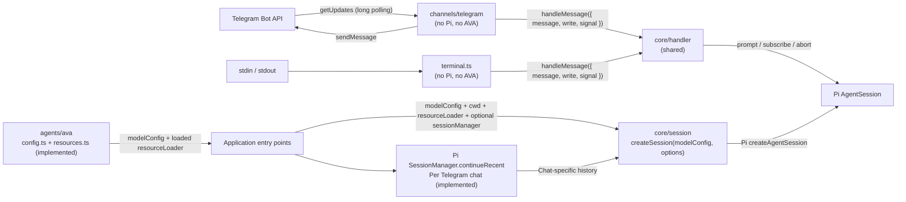
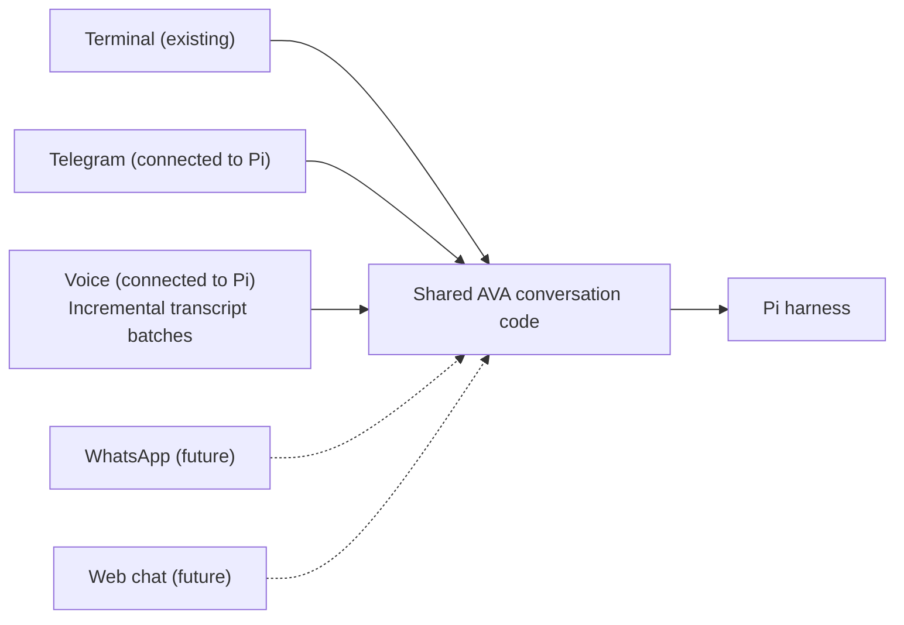

# Telegram channel plan

Status: **Telegram connected to Pi; persistent per-chat session resume implemented and confirmed by the owner.** The original implementation used `feature/telegram-channel`.

This plan adds Telegram as a second conversation channel for AVA. It also shapes the code so Pi can later serve as the harness for other agents, without building a framework before a second agent exists.

## Goals

- Talk to AVA through a Telegram bot, with the same Pi session behavior as the terminal.
- Keep channels independent of Pi and of any specific agent.
- Prepare clear boundaries for future agents built on Pi, without speculative abstractions.

## Non-goals

- Packaging a reusable npm library, a monorepo, or an agent registry.
- Abstracting over Pi itself.
- Media messages, inline keyboards, webhooks, or group chats.
- Tools, calendar integration, long-term memory, or Pi Durable.

## Current state

- `src/terminal.ts` doesn't depend on Pi. It passes a handler `{ message, write, signal }`.
- `src/core/handler.ts` exports `createMessageHandler(session)`, extracted by the owner. `src/terminal-preview.ts` creates it from one Pi session, passes it to the terminal, and retains session disposal.
- `src/agents/ava/config.ts` validates the `AVA_*` model variables when it is imported and exports a global `modelConfig`.
- `src/agents/ava/resources.ts` creates and reloads Pi's `DefaultResourceLoader` with `noContextFiles: true` and an empty append-system override, preserving `.pi/SYSTEM.md` discovery.
- `src/core/session.ts` exports `createSession(modelConfig, options)`. Both entry points supply AVA settings, `cwd`, and the loaded resource loader; Telegram also supplies its chat-specific `sessionManager`. The old `src/config/runtime.ts` has been removed; the core does not choose AVA's context policy.
- The installed Pi SDK offers `SessionManager.inMemory()`, `create()`, and `continueRecent()`. `DefaultResourceLoader` offers `noContextFiles`, `noSkills`, `noExtensions`, `systemPrompt`, and `appendSystemPrompt`.
- The Telegram channel uses the Bot API directly and remains independent of Pi. `src/telegram.ts` now composes real Pi conversations and selects history with `SessionManager.continueRecent(cwd, sessionDir)`, where the directory is derived from each chat ID.
- On 2026-10-12, the owner tested the real Telegram bot and confirmed successful session resume after restarting. Fourteen Telegram tests and four terminal tests cover channel behavior through injected conversations; they do not exercise Pi history resume end to end. Thirteen voice delegation tests, nine voice-connection tests, three voice-storage tests, five expression tool/client tests, and eight time/search tests now bring the repository total to 56.
- No Telegram library is installed.
- Voice now uses `ws` to attach to Ava Orb's GPT-Live session and reuses `Conversation` with a Pi backend implemented by the owner. It sends incremental transcript batches into one Pi session per backend launch, with explicitly selected storage in a directory per Live call and a logged JSONL path. This does not change Telegram behavior or share its history. See [the architecture](../ARCHITECTURE.md#voice-channel-gpt-live-with-a-pi-backend) for its current flow and limitations.

## Pi as a harness for future agents

Pi owns the agent loop, model requests, context assembly, sessions, and tools. Each agent should only supply its persona, configuration, and its tools.

Resource and configuration boundaries:

1. **Context policy (implemented).** `src/agents/ava/resources.ts` sets `noContextFiles: true` in Pi's `DefaultResourceLoader` so coding guidelines such as `AGENTS.md` are not automatically added to AVA's context. The persona stays in `.pi/SYSTEM.md`; context-file discovery is separate from system-prompt discovery and session history. The empty append-system override is preserved. Other resource discovery keeps Pi's defaults. The loader is reloaded before session creation; no custom context manager is introduced.
2. **Model settings and resource injection (implemented).** `createSession(modelConfig, options)` accepts validated model configuration and `Pick<CreateAgentSessionOptions, "cwd" | "resourceLoader" | "sessionManager" | "customTools" | "tools">`. Both entry points choose AVA's settings and loader and pass the same `cwd` to loader and session. Telegram additionally selects its chat-specific manager. The core forwards native options to Pi without importing AVA modules.

Principle: **draw the boundaries now and build the framework later.** Extract a shared package once a second agent actually needs this code.

## Architecture and remaining folder move

Confirmed folder layout: separate `src/core/`, `src/channels/`, and `src/agents/ava/`. Current entry points are `src/terminal-preview.ts` and `src/telegram.ts`; the terminal interface still lives in `src/terminal.ts`. Moving that interface into `src/channels/` and renaming its entry point remain planned. This is an internal module split; it does not introduce a framework or a shared package. The persona remains in `.pi/SYSTEM.md`.

| Layer | Contents | Shared or per agent |
| --- | --- | --- |
| Channels (`src/terminal.ts`, `src/channels/telegram/`) | Input/output only, connected through the `{ message, write, signal }` handler. The terminal folder move is deferred. | Shared |
| Pi core (`src/core/session.ts`, `src/core/handler.ts`) | Implemented: `createSession(modelConfig, options)` with native resource-loader injection, and the prompt/subscribe/abort handler. Telegram supplies a chat-specific persistent manager; the terminal uses Pi's default. | Shared |
| Agent definition (`src/agents/ava/`) | Implemented: `config.ts` validates model settings; `resources.ts` configures and reloads Pi's native loader. Voice now injects time, web search, and optional `set_expression` through native Pi tool options; Telegram tools remain disabled. Her persona remains in `.pi/SYSTEM.md`. | Per agent |
| Entry points (`src/terminal-preview.ts`, `src/telegram.ts`) | Combine one agent with one channel. | Per agent and channel |

## Channel boundaries and future channels

Terminal, Telegram, and voice are connected to Pi through separate application entry points. Voice integration was added after the Telegram milestone and now sends incremental transcript batches; its session is separate from Telegram. WhatsApp and a web text-chat interface similar to ChatGPT are future possibilities, not part of the Telegram implementation.

- Each channel handles its own incoming messages, commands, and outgoing responses.
- The shared AVA conversation code uses Pi for prompting, context assembly, and session history. New channels should reuse this code rather than duplicate it.
- A channel receives a conversation factory that returns a message handler and a cleanup function. It does not receive or import a Pi `AgentSession`; the application wiring connects the channel to the Pi implementation.
- Keep these boundaries small. Do not add WhatsApp, a web interface, or a general channel framework during the Telegram milestone.
- Using the same agent across channels does not automatically mean sharing one conversation history. Whether and how a user continues the same conversation across Telegram, WhatsApp, and the web remains a future decision. Do not assume that user or chat identifiers from different channels refer to the same person or conversation.

The shared box represents reusable conversation code, not a single session shared by all channels.

### Confirmed history behavior

Implemented for Telegram: `src/telegram.ts` derives ``join(getAgentDir(), "sessions", `ava-telegram-${conversationId}`)`` and supplies `SessionManager.continueRecent(cwd, sessionDir)` to the factory. This stable directory associates each chat with its saved history across restarts, keeping it separate from terminal history. Discovery is restricted to that chat's directory and the matching `cwd`; the owner confirmed live resume. Pending requests and polling offsets remain in memory.

The existing terminal already uses Pi's default file persistence, but its current entry point creates a fresh session on each launch. Saving history and automatically resuming it are separate behaviors.

## Telegram design

Design choices (confirmed decisions are marked; the other choices remain proposals):

1. **Direct Bot API client (confirmed).** Use the Bot API directly with Node's built-in `fetch` and long polling (`getUpdates`). No webhook, public URL, or server is needed. grammY is the alternative if media, keyboards, or webhooks are needed later.
2. **Owner-only private chat (confirmed).** `TELEGRAM_ALLOWED_USER_IDS` is required and initially contains only the owner's numeric Telegram user ID. Check both the sender ID and `chat.type === "private"` before creating a session or calling the model. Ignore other users, groups, and channels.
3. **Streaming from the first version (confirmed).** Show progress while Pi prepares the response, accumulate its text deltas, and update a temporary preview with Telegram's `sendMessageDraft`. Coalesce updates rather than making one request for every delta. Publish the final text with `sendMessage`, because drafts are temporary. Split long output within Telegram's 4096-character limit. Stop preview updates on cancellation or completion.
4. **One persistent Pi session per chat (confirmed).** Create it for a new chat, reuse the same live session during execution, and resume its saved history after restarting. Keep Telegram history separate from terminal history.
5. **One message at a time per chat.** Ordinary messages wait in a queue for that chat. Polling and command dispatch continue while a model response is being generated; the polling loop must not wait for a queued prompt to finish.
6. **Cancellation (confirmed).** `/start` shows a greeting. `/cancel` bypasses the ordinary message queue and interrupts the active reply through the handler's `signal` → `session.abort()`. Give each active request a fresh abort controller. Following the owner's latest written selection, cancellation clears pending messages and reports how many were discarded.
7. **Shutdown:** SIGINT/SIGTERM stops polling, cancels any reply in progress, and disposes every session.

### Configuration

| Variable | Purpose |
| --- | --- |
| `TELEGRAM_BOT_TOKEN` | Bot token from @BotFather. Kept in `.env`, never committed. |
| `TELEGRAM_ALLOWED_USER_IDS` | Comma-separated Telegram user IDs; initially only the owner's ID. |

These are validated in a separate settings module, so the terminal never needs a bot token.

## Files and implementation status

| File | Change |
| --- | --- |
| `src/core/handler.ts` | **Implemented by the owner.** Exports `createMessageHandler(session)`; both terminal and Telegram use it. |
| `src/core/session.ts` | **Implemented by the owner.** `createSession(modelConfig, options)` receives model settings and native `cwd` / `resourceLoader` / `sessionManager` options. Replaces the removed `config/runtime.ts`. |
| `src/agents/ava/config.ts`, `src/agents/ava/resources.ts` | **Implemented by the owner.** AVA's model configuration and policy through Pi's resource loader. The persona stays in `.pi/SYSTEM.md`. |
| `src/channels/terminal.ts` | **Planned.** Moved from `src/terminal.ts`. Behavior doesn't change. |
| `src/channels/telegram/bot-api.ts` | **Implemented.** A small Bot API client (`getUpdates`, `sendMessageDraft`, `sendMessage`, and progress indication as needed). `fetch` is passed in so tests can replace it. |
| `src/channels/telegram/channel.ts` | **Implemented.** Polling loop, allowed-user check, per-chat queue, commands, streaming previews, final delivery, and splitting. Receives a conversation factory that returns a message handler and a cleanup function; does not receive or import a Pi session. |
| `src/channels/telegram/settings.ts` | **Implemented.** Validates `TELEGRAM_BOT_TOKEN` and `TELEGRAM_ALLOWED_USER_IDS`. |
| `src/terminal.ts`, `src/telegram.ts` | **Target entry points.** Currently `terminal-preview.ts` composes the real AVA session, `terminal.ts` is the terminal input loop, and `telegram.ts` composes real Pi conversations with chat-specific history resume. |
| `package.json` | **Implemented.** Adds a `"telegram"` script that builds the code and runs the entry point with `.env`. |
| `test/telegram.test.mjs` | **Implemented.** Uses a fake Bot API, so no model or network is called. |
| `README.md`, `ARCHITECTURE.md`, `AGENTS.md` | Bot setup, updated diagrams, and the new layout table. |

### Tests

- Messages from other users and non-private chats are ignored before any model work.
- Text deltas update the preview, completed replies are published, and long replies are split at the 4096-character limit.
- Messages in a chat are handled in order.
- After an error, the bot reports it and still handles the next message.
- `/cancel` is received during an active generation, bypasses the queue, aborts the reply, and stops preview updates.
- Conversations are isolated by chat and disposed on shutdown. The owner confirmed real Pi session resume after restarting; automated persistence/resume coverage remains a follow-up.

## Implementation order and ownership

Confirmed sequence: build and test the channel without a model first. The owner implements the Pi core afterward, one component at a time.

1. **Owner — completed:** create the Telegram bot and configure its token and allowed user ID locally.
2. **Coding assistant — completed:** add the channel contract, settings, direct Bot API client, per-chat queue, streaming previews, cancellation, cleanup, and simulated reply entry point.
3. **Coding assistant — completed:** add the local identification helper, run type checking and the eighteen local tests. The owner confirmed the live simulated response arrived in Telegram.
4. **Owner — completed:** extract `createMessageHandler(session)` and `createSession(modelConfig, options)`; separate AVA's `config.ts` and `resources.ts`; connect them through the terminal entry point. The native loader now applies the agreed context-file policy while keeping `.pi/SYSTEM.md` in place.
5. **Owner — completed:** expose native session-manager injection, derive a directory per Telegram chat, select history with `SessionManager.continueRecent`, and replace the simulated factory with the Pi-backed factory. Live session resume was confirmed on 2026-10-12.
6. **Owner:** complete the terminal folder move and entry-point refactor when ready. The terminal input module is still in its original location; its entry point now uses the extracted handler.
7. **Live verification completed by the owner:** session resume worked in Telegram. Add focused automated persistence/resume tests and continue updating diagrams as future steps are implemented.

### Implemented files

- `src/core/handler.ts`: the shared Pi message handler, connected through the terminal and Telegram entry points.
- `src/core/session.ts`: `ModelConfig` and `createSession(modelConfig, options)` with native `cwd` / `resourceLoader` / `sessionManager` forwarding.
- `src/agents/ava/config.ts`: AVA model environment validation.
- `src/agents/ava/resources.ts`: AVA's native Pi loader, context-file policy, and resource reload before session creation.
- `src/channels/contracts.ts`: a channel-independent conversation factory, message handler, and cleanup contract.
- `src/channels/telegram/{settings,bot-api,channel}.ts`: Telegram input/output and lifecycle.
- `src/telegram.ts`: real AVA conversation factory, chat-specific Pi storage selection, shared handler, and session disposal.
- `src/telegram-identify.ts`: local owner-ID discovery using a temporary phrase.
- `test/telegram.test.mjs`: fourteen tests, alongside the four existing terminal tests.
- `package.json`: `npm run telegram` and `npm run telegram:identify`.

The earlier table distinguishes current modules from target paths. Both channels now use the Pi handler, session factory, and AVA configuration and resource policy. Telegram history selection, persistence, resume, and Pi wiring are implemented; the owner confirmed live resume. The terminal folder move, automated Pi persistence coverage, and delivery recovery remain follow-ups. See `ARCHITECTURE.md` for verification details.

## Deferred delivery recovery

Confirmed decision: implement robust recovery from connection and delivery failures in a later iteration. Record it here so it is not lost; it is not part of the first Telegram milestone.

- Add controlled reconnection, backoff, and handling of Telegram retry instructions.
- When final delivery fails, retry sending the already-generated response rather than automatically asking the model to generate it again.
- Define update acknowledgement, restart recovery for queued messages, and duplicate-delivery behavior before promising reliable recovery. Pi session persistence alone does not guarantee Telegram message delivery.

The first version should surface errors and allow cancellation and shutdown. It does not promise automatic recovery or exactly-once delivery.

Streaming reference: [Telegram Bot API — sendMessageDraft](https://core.telegram.org/bots/api#sendmessagedraft). Draft previews are temporary and require a final `sendMessage` call to persist the answer in the chat.

## Decision status

The channel milestone has no blocking open decisions. The latest written cancellation choice is to interrupt the active response and clear pending requests. Pi integration and chat history resume are complete; delivery recovery remains deferred, and future implementation remains owner-led.
