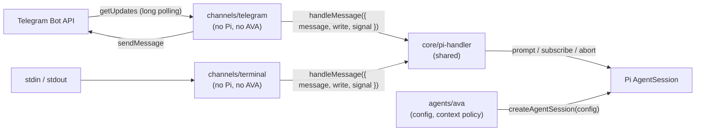
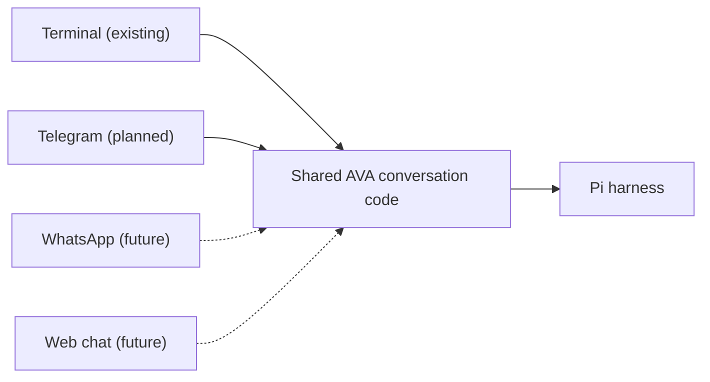

# Telegram channel plan

Status: **Telegram channel preview implemented; Pi integration remains for the owner.** Branch: `feature/telegram-channel`.

This plan adds Telegram as a second conversation channel for AVA. It also shapes the code so Pi can later serve as the harness for other agents, without building a framework before a second agent exists.

## Goals

- Talk to AVA through a Telegram bot, with the same Pi session behavior as the terminal.
- Keep channels independent of Pi and of any specific agent.
- Prepare clear boundaries for future agents built on Pi, without speculative abstractions.

## Non-goals

- Packaging a reusable npm library, a monorepo, or an agent registry.
- Abstracting over Pi itself.
- Media messages, inline keyboards, webhooks, or group chats.
- Tools, calendar integration, long-term memory, or Pi Durable.

## Current state

- `src/terminal.ts` doesn't depend on Pi. It passes a handler `{ message, write, signal }`.
- `src/terminal-preview.ts` connects that handler to one Pi session.
- `src/config/settings.ts` validates the `AVA_*` model variables when it is imported and exports a global `modelConfig`.
- `src/config/runtime.ts` creates the session from that global config. Its `DefaultResourceLoader` reads files from `process.cwd()`, so it also loads this repository's `AGENTS.md` (the coding guidelines) as AVA's context.
- The installed Pi SDK offers `SessionManager.inMemory()`, `create()`, and `continueRecent()`. `DefaultResourceLoader` offers `noContextFiles`, `noSkills`, `noExtensions`, `systemPrompt`, and `appendSystemPrompt`.
- The Telegram channel now uses the Bot API directly and a simulated streaming handler. It imports no Pi runtime and makes no model calls.
- The owner confirmed receiving the simulated response in Telegram. Eighteen local tests pass, including the existing terminal tests.
- No Telegram library is installed.

## Pi as a harness for future agents

Pi owns the agent loop, model requests, context assembly, sessions, and tools. Each agent should only supply its persona, configuration, and (later) its tools.

Resource and configuration boundaries:

1. **Context policy (confirmed, pending implementation).** Set `noContextFiles: true` in AVA's `DefaultResourceLoader` so coding guidelines such as `AGENTS.md` are not automatically added to her context. Keep the persona in `.pi/SYSTEM.md`; disabling context-file discovery does not require moving it or disabling system-prompt discovery. Preserve this policy when extracting the session factory. Resource policies for other agents can be introduced when needed.
2. **Global settings.** The session factory reads a module-level config. It should take the agent's config as a parameter.

Principle: **draw the boundaries now and build the framework later.** Extract a shared package once a second agent actually needs this code.

## Target architecture

Confirmed folder layout: separate `src/core/`, `src/channels/`, and `src/agents/ava/` now. Keep entry points in `src/terminal.ts` and `src/telegram.ts`. This is an internal module split; it does not introduce a framework or a shared package. The persona remains in `.pi/SYSTEM.md`.

| Layer | Contents | Shared or per agent |
| --- | --- | --- |
| Channels (`src/channels/terminal.ts`, `src/channels/telegram/`) | Input/output only, connected through the `{ message, write, signal }` handler. | Shared |
| Pi core (`src/core/session.ts`, `src/core/pi-handler.ts`) | `createAgentSession(config)` with the model, thinking level, and resources passed in, plus the shared prompt/subscribe/abort handler. | Shared |
| Agent definition (`src/agents/ava/`) | AVA's config: env prefix, context policy, and later her tools. Her persona remains in `.pi/SYSTEM.md`. | Per agent |
| Entry points (`src/terminal.ts`, `src/telegram.ts`) | Combine one agent with one channel. | Per agent and channel |

## Channel boundaries and future channels

Confirmed direction: Telegram is the next channel. WhatsApp and a web chat interface similar to ChatGPT are future possibilities, not part of this implementation.

- Each channel handles its own incoming messages, commands, and outgoing responses.
- The shared AVA conversation code uses Pi for prompting, context assembly, and session history. New channels should reuse this code rather than duplicate it.
- A channel receives a conversation factory that returns a message handler and a cleanup function. It does not receive or import a Pi `AgentSession`; the application wiring connects the channel to the Pi implementation.
- Keep these boundaries small. Do not add WhatsApp, a web interface, or a general channel framework during the Telegram milestone.
- Using the same agent across channels does not automatically mean sharing one conversation history. Whether and how a user continues the same conversation across Telegram, WhatsApp, and the web remains a future decision. Do not assume that user or chat identifiers from different channels refer to the same person or conversation.

The shared box represents reusable conversation code, not a single session shared by all channels.

### Confirmed history behavior

For Telegram, persist each chat's Pi session and resume that same conversation after restarting the application. Keep Telegram history separate from terminal history when Pi is connected. The current simulated channel has no persisted conversation history. The mapping from a Telegram chat to its saved Pi session must survive restarts; do not select the most recent session across all channels.

The existing terminal already uses Pi's default file persistence, but its current entry point creates a fresh session on each launch. Saving history and automatically resuming it are separate behaviors.

## Telegram design

Design choices (confirmed decisions are marked; the other choices remain proposals):

1. **Direct Bot API client (confirmed).** Use the Bot API directly with Node's built-in `fetch` and long polling (`getUpdates`). No webhook, public URL, or server is needed. grammY is the alternative if media, keyboards, or webhooks are needed later.
2. **Owner-only private chat (confirmed).** `TELEGRAM_ALLOWED_USER_IDS` is required and initially contains only the owner's numeric Telegram user ID. Check both the sender ID and `chat.type === "private"` before creating a session or calling the model. Ignore other users, groups, and channels.
3. **Streaming from the first version (confirmed).** Show progress while Pi prepares the response, accumulate its text deltas, and update a temporary preview with Telegram's `sendMessageDraft`. Coalesce updates rather than making one request for every delta. Publish the final text with `sendMessage`, because drafts are temporary. Split long output within Telegram's 4096-character limit. Stop preview updates on cancellation or completion.
4. **One persistent Pi session per chat (confirmed).** Create it for a new chat, reuse the same live session during execution, and resume its saved history after restarting. Keep Telegram history separate from terminal history.
5. **One message at a time per chat.** Ordinary messages wait in a queue for that chat. Polling and command dispatch continue while a model response is being generated; the polling loop must not wait for a queued prompt to finish.
6. **Cancellation (confirmed).** `/start` shows a greeting. `/cancel` bypasses the ordinary message queue and interrupts the active reply through the handler's `signal` → `session.abort()`. Give each active request a fresh abort controller. Following the owner's latest written selection, cancellation clears pending messages and reports how many were discarded.
7. **Shutdown:** SIGINT/SIGTERM stops polling, cancels any reply in progress, and disposes every session.

### Configuration

| Variable | Purpose |
| --- | --- |
| `TELEGRAM_BOT_TOKEN` | Bot token from @BotFather. Kept in `.env`, never committed. |
| `TELEGRAM_ALLOWED_USER_IDS` | Comma-separated Telegram user IDs; initially only the owner's ID. |

These are validated in a separate settings module, so the terminal never needs a bot token.

## Planned files

| File | Change |
| --- | --- |
| `src/core/pi-handler.ts` | **New.** Moves the handler code out of `terminal-preview.ts` as `createPiMessageHandler(session)`. |
| `src/core/session.ts` | **New** (from `config/runtime.ts`). `createAgentSession(config)` takes the model and resources as parameters. |
| `src/agents/ava/` | **New.** AVA's configuration and context policy. Keep the persona in `.pi/SYSTEM.md`. |
| `src/channels/terminal.ts` | Moved from `src/terminal.ts`. Behavior doesn't change. |
| `src/channels/telegram/bot-api.ts` | **New.** A small Bot API client (`getUpdates`, `sendMessageDraft`, `sendMessage`, and progress indication as needed). `fetch` is passed in so tests can replace it. |
| `src/channels/telegram/channel.ts` | **New.** Polling loop, allowed-user check, per-chat queue, commands, streaming previews, final delivery, and splitting. Receives a conversation factory that returns a message handler and a cleanup function; does not receive or import a Pi session. |
| `src/channels/telegram/settings.ts` | **New.** Validates `TELEGRAM_BOT_TOKEN` and `TELEGRAM_ALLOWED_USER_IDS`. |
| `src/terminal.ts`, `src/telegram.ts` | Entry points that combine AVA with a channel. They replace `terminal-preview.ts`. |
| `package.json` | Adds a `"telegram"` script that builds the code and runs the entry point with `.env`. |
| `test/telegram.test.mjs` | **New.** Uses a fake Bot API, so no model or network is called. |
| `README.md`, `ARCHITECTURE.md`, `AGENTS.md` | Bot setup, updated diagrams, and the new layout table. |

### Tests

- Messages from other users and non-private chats are ignored before any model work.
- Text deltas update the preview, completed replies are published, and long replies are split at the 4096-character limit.
- Messages in a chat are handled in order.
- After an error, the bot reports it and still handles the next message.
- `/cancel` is received during an active generation, bypasses the queue, aborts the reply, and stops preview updates.
- Sessions are isolated by chat, resume after restart, and are disposed on shutdown.

## Implementation order and ownership

Confirmed sequence: build and test the channel without a model first. The owner implements the Pi core afterward, one component at a time.

1. **Owner — completed:** create the Telegram bot and configure its token and allowed user ID locally.
2. **Coding assistant — completed:** add the channel contract, settings, direct Bot API client, per-chat queue, streaming previews, cancellation, cleanup, and simulated reply entry point.
3. **Coding assistant — completed:** add the local identification helper, run type checking and the eighteen local tests. The owner confirmed the live simulated response arrived in Telegram.
4. **Owner — next:** extract the Pi handler, create the configurable session factory, and define AVA's configuration. Apply the agreed context policy while keeping `.pi/SYSTEM.md` in place.
5. **Owner:** add chat-to-Pi-session persistence and resume behavior, then replace the simulated conversation factory with the Pi-backed factory.
6. **Owner:** complete the terminal folder move and entry-point refactor when ready. The existing terminal and Pi files remain unchanged in this first implementation.
7. Verify real model behavior after the owner connects Pi, and update the diagrams and setup instructions as each step is completed.

### Implemented files

- `src/channels/contracts.ts`: a channel-independent conversation factory, message handler, and cleanup contract.
- `src/channels/telegram/{settings,bot-api,channel}.ts`: Telegram input/output and lifecycle.
- `src/telegram.ts`: simulated streaming conversation; the future Pi integration point is its `createConversation` callback.
- `src/telegram-identify.ts`: local owner-ID discovery using a temporary phrase.
- `test/telegram.test.mjs`: fourteen tests, alongside the four existing terminal tests.
- `package.json`: `npm run telegram` and `npm run telegram:identify`.

The earlier file table describes the target architecture; `core/`, `agents/ava/`, the terminal move, and Pi-backed persistence are still future owner work.

## Deferred delivery recovery

Confirmed decision: implement robust recovery from connection and delivery failures in a later iteration. Record it here so it is not lost; it is not part of the first Telegram milestone.

- Add controlled reconnection, backoff, and handling of Telegram retry instructions.
- When final delivery fails, retry sending the already-generated response rather than automatically asking the model to generate it again.
- Define update acknowledgement, restart recovery for queued messages, and duplicate-delivery behavior before promising reliable recovery. Pi session persistence alone does not guarantee Telegram message delivery.

The first version should surface errors and allow cancellation and shutdown. It does not promise automatic recovery or exactly-once delivery.

Streaming reference: [Telegram Bot API — sendMessageDraft](https://core.telegram.org/bots/api#sendmessagedraft). Draft previews are temporary and require a final `sendMessage` call to persist the answer in the chat.

## Decision status

The channel milestone has no blocking open decisions. The latest written cancellation choice is to interrupt the active response and clear pending requests. Delivery recovery remains deferred; Pi integration belongs to the owner.
